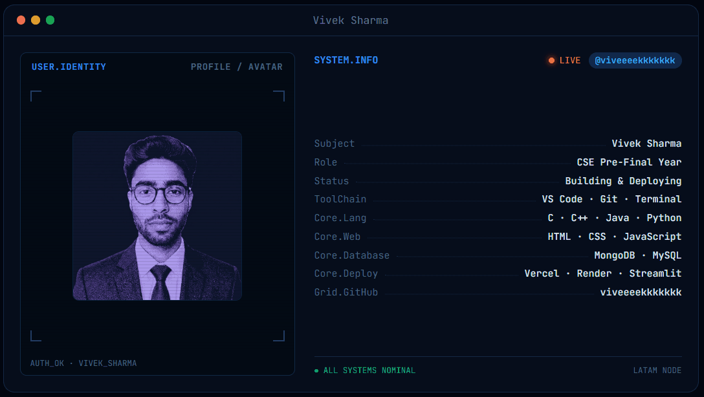

<!-- THEME-SYNCED TERMINAL CARD BANNER -->
<picture>
  <source media="(prefers-color-scheme: dark)" srcset="assets/banner-dark.gif">
  <source media="(prefers-color-scheme: light)" srcset="assets/banner-light.gif">
  
</picture>

 

<!-- DYNAMIC TYPING SVG (Theme Synchronized) -->
<a href="https://github.com/viveeeekkkkkkk">
  <picture>
    <source media="(prefers-color-scheme: dark)" srcset="https://readme-typing-svg.demolab.com?font=JetBrains+Mono&weight=600&size=24&duration=2500&pause=900&color=38BDF8&center=true&vCenter=true&width=880&lines=Vivek+Sharma+-+CSE+Pre-Final+Year;Building+%26+Deploying+Full-Stack+Apps;C+%C2%B7+C%2B%2B+%C2%B7+Java+%C2%B7+Python+%C2%B7+Web+Dev">
    <source media="(prefers-color-scheme: light)" srcset="https://readme-typing-svg.demolab.com?font=JetBrains+Mono&weight=600&size=24&duration=2500&pause=900&color=0284C7&center=true&vCenter=true&width=880&lines=Vivek+Sharma+-+CSE+Pre-Final+Year;Building+%26+Deploying+Full-Stack+Apps;C+%C2%B7+C%2B%2B+%C2%B7+Java+%C2%B7+Python+%C2%B7+Web+Dev">
    
  </picture>
</a>

 

<!-- SOCIAL BADGES (Theme Synchronized) -->
<a href="https://github.com/viveeeekkkkkkk">
  <picture>
    <source media="(prefers-color-scheme: dark)" srcset="https://img.shields.io/badge/GitHub-060d1a?style=for-the-badge&logo=github&logoColor=38bdf8">
    <source media="(prefers-color-scheme: light)" srcset="https://img.shields.io/badge/GitHub-f1f5f9?style=for-the-badge&logo=github&logoColor=0284c7">
    
  </picture>
</a>&nbsp;&nbsp;
&nbsp;&nbsp;
<a href="mailto:codes.viveksharma@gmail.com">
  <picture>
    <source media="(prefers-color-scheme: dark)" srcset="https://img.shields.io/badge/Email-060d1a?style=for-the-badge&logo=gmail&logoColor=ef4444">
    <source media="(prefers-color-scheme: light)" srcset="https://img.shields.io/badge/Email-f1f5f9?style=for-the-badge&logo=gmail&logoColor=ea4335">
    
  </picture>
</a>

---

## About Me :)

- 🎓 Computer Science and Engineering undergraduate.
- 💻 Interested in software development and emerging technologies.
- 🏆 Participated in hackathons and collaborative project development.
- 🌐 Exploring software solutions through practical projects.
- 🎯 Aspiring to build reliable and impactful technology.

 

## My Perfect Stack

  

<!-- Deployment & Framework Badges -->
&nbsp;

---

## Signals & Competency Radar

<table border="0" align="center">
<tr>
<td width="50%" align="center" valign="middle">

<!-- Radar 1: Core Skills Radar (Dark/Light Synchronized) -->
<picture>
  <source media="(prefers-color-scheme: dark)" srcset="https://quickchart.io/chart?c=%7Btype%3A%27radar%27%2Cdata%3A%7Blabels%3A%5B%27DSA%27%2C%27OOP%2FJava%27%2C%27Web%20Dev%27%2C%27Databases%27%2C%27Git%2FDevOps%27%2C%27Problem%20Solving%27%5D%2Cdatasets%3A%5B%7Blabel%3A%27Skill%20Radar%27%2Cdata%3A%5B88%2C90%2C82%2C80%2C78%2C86%5D%2CbackgroundColor%3A%27rgba(56%2C189%2C248%2C0.25)%27%2CborderColor%3A%27rgba(56%2C189%2C248%2C1)%27%2CpointBackgroundColor%3A%27%2338bdf8%27%7D%5D%7D%2Coptions%3A%7Blegend%3A%7Bdisplay%3Afalse%7D%2Ctitle%3A%7Bdisplay%3Atrue%2Ctext%3A%27Core%20Skill%20Radar%27%2CfontColor%3A%27%2338bdf8%27%2CfontSize%3A15%7D%2Cscale%3A%7Bticks%3A%7Bdisplay%3Afalse%2CbeginAtZero%3Atrue%2Cmax%3A100%7D%2CgridLines%3A%7Bcolor%3A%27rgba(255%2C255%2C255%2C0.12)%27%7D%2CpointLabels%3A%7BfontColor%3A%27%2394a3b8%27%2CfontSize%3A11%7D%7D%7D%7D&w=380&h=320&bkg=transparent">
  <source media="(prefers-color-scheme: light)" srcset="https://quickchart.io/chart?c=%7Btype%3A%27radar%27%2Cdata%3A%7Blabels%3A%5B%27DSA%27%2C%27OOP%2FJava%27%2C%27Web%20Dev%27%2C%27Databases%27%2C%27Git%2FDevOps%27%2C%27Problem%20Solving%27%5D%2Cdatasets%3A%5B%7Blabel%3A%27Skill%20Radar%27%2Cdata%3A%5B88%2C90%2C82%2C80%2C78%2C86%5D%2CbackgroundColor%3A%27rgba(14%2C165%2C233%2C0.2)%27%2CborderColor%3A%27rgba(14%2C165%2C233%2C1)%27%2CpointBackgroundColor%3A%27%230284c7%27%7D%5D%7D%2Coptions%3A%7Blegend%3A%7Bdisplay%3Afalse%7D%2Ctitle%3A%7Bdisplay%3Atrue%2Ctext%3A%27Core%20Skill%20Radar%27%2CfontColor%3A%27%230284c7%27%2CfontSize%3A15%7D%2Cscale%3A%7Bticks%3A%7Bdisplay%3Afalse%2CbeginAtZero%3Atrue%2Cmax%3A100%7D%2CgridLines%3A%7Bcolor%3A%27rgba(0%2C0%2C0%2C0.1)%27%7D%2CpointLabels%3A%7BfontColor%3A%27%23334155%27%2CfontSize%3A11%7D%7D%7D%7D&w=380&h=320&bkg=transparent">
  
</picture>

</td>
<td width="50%" align="center" valign="middle">

<!-- Radar 2: Language Stack Radar (Dark/Light Synchronized) -->
<picture>
  <source media="(prefers-color-scheme: dark)" srcset="https://quickchart.io/chart?c=%7Btype%3A%27radar%27%2Cdata%3A%7Blabels%3A%5B%27Java%27%2C%27C%2B%2B%27%2C%27C%27%2C%27JavaScript%27%2C%27Python%27%2C%27SQL%27%5D%2Cdatasets%3A%5B%7Blabel%3A%27Language%20Stack%27%2Cdata%3A%5B90%2C85%2C82%2C84%2C80%2C83%5D%2CbackgroundColor%3A%27rgba(52%2C211%2C153%2C0.25)%27%2CborderColor%3A%27rgba(52%2C211%2C153%2C1)%27%2CpointBackgroundColor%3A%27%2334d399%27%7D%5D%7D%2Coptions%3A%7Blegend%3A%7Bdisplay%3Afalse%7D%2Ctitle%3A%7Bdisplay%3Atrue%2Ctext%3A%27Language%20Stack%27%2CfontColor%3A%27%2334d399%27%2CfontSize%3A15%7D%2Cscale%3A%7Bticks%3A%7Bdisplay%3Afalse%2CbeginAtZero%3Atrue%2Cmax%3A100%7D%2CgridLines%3A%7Bcolor%3A%27rgba(255%2C255%2C255%2C0.12)%27%7D%2CpointLabels%3A%7BfontColor%3A%27%2394a3b8%27%2CfontSize%3A11%7D%7D%7D%7D&w=380&h=320&bkg=transparent">
  <source media="(prefers-color-scheme: light)" srcset="https://quickchart.io/chart?c=%7Btype%3A%27radar%27%2Cdata%3A%7Blabels%3A%5B%27Java%27%2C%27C%2B%2B%27%2C%27C%27%2C%27JavaScript%27%2C%27Python%27%2C%27SQL%27%5D%2Cdatasets%3A%5B%7Blabel%3A%27Language%20Stack%27%2Cdata%3A%5B90%2C85%2C82%2C84%2C80%2C83%5D%2CbackgroundColor%3A%27rgba(16%2C185%2C129%2C0.2)%27%2CborderColor%3A%27rgba(16%2C185%2C129%2C1)%27%2CpointBackgroundColor%3A%27%23059669%27%7D%5D%7D%2Coptions%3A%7Blegend%3A%7Bdisplay%3Afalse%7D%2Ctitle%3A%7Bdisplay%3Atrue%2Ctext%3A%27Language%20Stack%27%2CfontColor%3A%27%23059669%27%2CfontSize%3A15%7D%2Cscale%3A%7Bticks%3A%7Bdisplay%3Afalse%2CbeginAtZero%3Atrue%2Cmax%3A100%7D%2CgridLines%3A%7Bcolor%3A%27rgba(0%2C0%2C0%2C0.1)%27%7D%2CpointLabels%3A%7BfontColor%3A%27%23334155%27%2CfontSize%3A11%7D%7D%7D%7D&w=380&h=320&bkg=transparent">
  
</picture>

</td>
</tr>
</table>

---

## GitHub Metrics

<!-- Borderless / Boxless GitHub Stats -->
<picture>
  <source media="(prefers-color-scheme: dark)" srcset="https://github-readme-stats.vercel.app/api?username=viveeeekkkkkkk&show_icons=true&theme=tokyonight&hide_border=true&bg_color=00000000&title_color=38bdf8&text_color=829ab1&icon_color=3b82f6">
  <source media="(prefers-color-scheme: light)" srcset="https://github-readme-stats.vercel.app/api?username=viveeeekkkkkkk&show_icons=true&theme=default&hide_border=true&bg_color=00000000&title_color=0284c7&text_color=334155&icon_color=0284c7">
  
</picture>

  

<!-- Borderless / Boxless Most Used Languages -->
<picture>
  <source media="(prefers-color-scheme: dark)" srcset="https://github-readme-stats.vercel.app/api/top-langs/?username=viveeeekkkkkkk&layout=compact&theme=tokyonight&hide_border=true&bg_color=00000000&title_color=38bdf8&text_color=829ab1&langs_count=6">
  <source media="(prefers-color-scheme: light)" srcset="https://github-readme-stats.vercel.app/api/top-langs/?username=viveeeekkkkkkk&layout=compact&theme=default&hide_border=true&bg_color=00000000&title_color=0284c7&text_color=334155&langs_count=6">
  
</picture>

</td>
</tr>
</table>

---

  Built with precision · @viveeeekkkkkkk

